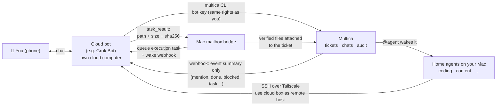

# virtual-bot-connect

**Let your cloud chat bots and your home AI agents talk to each other — and wake each other up.**

[中文说明](README.zh-CN.md) · MIT licensed · design notes + sanitized examples

You talk to a cloud bot (for example a [Grok](https://grok.com) Bot) from your phone. Your real work happens
at home, in [Multica](https://github.com/multica-ai/multica), where coding and content agents run on your Mac
with all your logins. This repo is the recipe for joining the two:

- the **bot acts as your front desk** — it reads and writes Multica directly (tickets, chats, files) and
  @-mentions the right home agent;
- the **bot's cloud computer acts as a remote machine** — agents on your Mac can SSH in over Tailscale and run jobs;
- **events wake the other side immediately** (webhooks), instead of everybody polling every 30 minutes.

The wake-up design borrows heavily from [Yobiru](https://github.com/chekusu/yobiru) by Guo Yu — see
[Acknowledgements](#acknowledgements).

> **Status:** working setup on one real account, shared as documentation. The bridge scripts and the Multica
> server changes live in other repositories and are not published here yet. Field names in the examples are
> illustrative — check them against your own versions.

## How it fits together



Who wakes whom:

| From → To | Trigger | Path |
|---|---|---|
| You → Bot | you send a message | the bot's own chat app |
| Bot → home agent | bot @-mentions an agent in a Multica ticket or chat | `multica` CLI with a bot key |
| Multica → Bot | an event the bot subscribed to (mention, task, done, blocked, needs-you…) | server POSTs the bot's routine webhook |
| Mac → Bot box | an agent needs a remote machine | `ssh <bot-host>` via Tailscale |
| Multica → Bot box (job) | a long job must run on the cloud computer | mailbox bridge + wake webhook |
| *(fallback)* | anything missed, throttled or muted | bot's routine polls every 30 min |

## Key ideas

1. **Multica stays the ledger.** Every ticket, chat, status and file lives there, so you can see everything from
   your phone. Bots are *clients* of Multica, not a parallel system.
2. **Bots get a real key.** A bot you add as an admin gets a personal token with your rights, marked as a bot
   key. Writes made with it are shown as **"via &lt;bot name&gt;"**, so a bot can never be mistaken for you
   (and never "approves" something in your name).
3. **The receiver decides who may wake it.** Each bot sets which events wake it, an hourly cap (default 6) and
   quiet hours (default 23:00–08:00). Events that are throttled are *queued for the next check*, never dropped.
4. **Messages carry pointers, not payloads.** A wake-up says *what happened and where*; the bot fetches the full
   text with its own credentials. Files travel as `{url, size, sha256}` and are verified before use.
5. **Delivered ≠ woken ≠ done.** Reports keep these three states apart and say "unknown" rather than guess.
   An uncertain write is never blindly retried.
6. **Outward actions are drafts first.** Posting publicly, messaging third parties or buying anything needs your
   explicit "send". Work inside Multica does not.

## Reuse it

### Prerequisites

- A [Multica](https://github.com/multica-ai/multica) workspace where you are admin, and the `multica` CLI.
- A cloud bot that has its own computer with a shell (Grok Bots do; check yours with the
  [new-bot checklist](docs/adding-a-new-bot.md)).
- [Tailscale](https://tailscale.com) on both machines if you want the remote-host path.
- Optional: a bot that can receive webhooks (Grok "Routines" can) for instant wake-ups.

### Step by step

1. **Give the bot a key.** In Multica create a token for the bot (a personal API token works; a fork with an
   "External bots" settings page adds bot marking and a revoke button). Never paste it into chat or a prompt —
   hand it over through a protected file or stdin. → [docs/multica-integration.md](docs/multica-integration.md)
2. **Install the CLI on the bot's computer** and log in from a fresh shell to prove it persists.
3. **Give the bot standing instructions**: routing (which home agent handles what), reporting style, the
   drafts-first rule, how to handle wake events. → [examples/standing-instructions.md](examples/standing-instructions.md)
4. **Wire wake-ups**: register the bot's webhook URL/key with Multica (write-only), then set its wake rules.
   → [examples/webhook/](examples/webhook/)
5. **Optional — remote host**: join the bot's computer to your tailnet, run `sshd` on a high port with keys
   only, add a watchdog. → [docs/grok.md](docs/grok.md), [examples/ssh/](examples/ssh/)
6. **Optional — execution mailbox** for long jobs with verified result files.
   → [examples/mailbox/](examples/mailbox/)
7. **Test each path with a real round trip** and write down what you did *not* test.

Adding another bot later: [docs/adding-a-new-bot.md](docs/adding-a-new-bot.md).

## Repository layout

```
README.md / README.zh-CN.md   overview (English / 中文)
docs/
  architecture.md             roles, channels, ground rules
  multica-integration.md      bot keys, "via bot" attribution, wake rules, CLI cheat sheet
  grok.md                     Grok Bot specifics: Tailscale + SSH, watchdog, pitfalls
  adding-a-new-bot.md         checklist for connecting another bot
examples/
  standing-instructions.md    long-lived instructions to paste into the bot
  webhook/                    wake event payload + wake rules
  mailbox/                    execution task / result message formats
  ssh/                        ssh_config and watchdog sketch
research/
  yobiru.md                   what we learned from Yobiru (English)
  yobiru.zh-CN.md             original Chinese notes
```

## Acknowledgements

The "agents wake each other up" model here — receiver-owned wake rules, small messages that point to content,
files fetched and checked by sha256, and keeping *delivered / woken / done* apart — comes from
**[Yobiru](https://github.com/chekusu/yobiru)** by **Guo Yu ([@turingou](https://x.com/turingou))**
([announcement](https://x.com/turingou/status/2109153922267107458)). Read its `SPEC.md`; it is the best part.
Our notes on what we adopted and what we did not: [research/yobiru.md](research/yobiru.md).

Thanks also to [Multica](https://github.com/multica-ai/multica) and [Tailscale](https://tailscale.com).

## License

[MIT](LICENSE)
