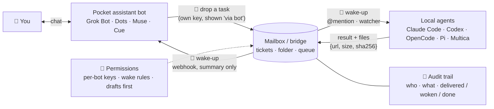

<p align="center">
  
</p>

<p align="center">
  <b>English</b> · <a href="README.zh-CN.md">简体中文</a>
</p>

<p align="center">
  <a href="LICENSE"></a>
  
  
  
  <a href="https://github.com/kkunkunya/virtual-bot-connect/stargazers"></a>
</p>

# virtual-bot-connect

**A doorbell between your pocket AI and your home agents.**

You chat with a personal-assistant bot on your phone (Grok Bot, Dots, Muse, Cue…). Your real work runs on your
own machine, in Claude Code, Codex, OpenCode, Pi or a multi-agent setup like Multica — with your repos and your
logins. Today you are the messenger between them: copy, paste, switch windows, check back later.

**virtual-bot-connect is a vendor-neutral recipe for wiring the two together with four small pieces:
a mailbox, a wake-up, permissions, and an audit trail.** The bot drops a task in the mailbox, the right local
agent wakes up and does it, the result comes back with proof, and every step is written down where you can see
it from your phone.

## Give this to your agent

Paste this into Claude Code, Codex, OpenCode, Pi or any agent that can read a URL:

```text
Fetch and follow https://raw.githubusercontent.com/kkunkunya/virtual-bot-connect/main/AGENTS.md
to connect me to my personal-assistant bot. First ask me which bot I use and which local agent
setup I run, then propose the smallest setup before changing anything. Never print, paste or
commit any of my keys.
```

Your agent reads the playbook, interviews you, checks what your bot can actually do (shell? webhooks? schedule?),
and builds the smallest bridge that fits. Nothing here is a black-box installer: every step is a document you can
read first.

<p align="center">
  
  <br><sub><i>Animated illustration of the flow, not a screen recording.</i></sub>
</p>

## The four pieces

| | Piece | What it does | Rule of thumb |
|---|---|---|---|
| 📮 | **Mailbox / bridge** | One place both sides can write to and read from: a ticket system, a shared folder, a queue. | Messages carry **pointers, not payloads**. Files travel as `{url, size, sha256}` and are checked before use. |
| 🔔 | **Wake-up** | A new message wakes the receiver at once (webhook, `@mention`, file watcher) instead of everyone polling. | **The receiver decides who may wake it**: event types, hourly cap, quiet hours. Polling stays as the backstop. |
| 🔐 | **Permissions** | Each bot gets its own revocable key; outward actions need your explicit yes. | **Drafts first** for anything public, paid or sent to third parties. Keys go in protected files, never in chat or argv. |
| 🧾 | **Audit trail** | Every request, wake-up, result and file is recorded with who did it ("via &lt;bot&gt;"). | Keep **delivered ≠ woken ≠ done** apart. Write "unknown" rather than guess. |

Full write-up with options for each piece: [docs/primitives.md](docs/primitives.md).

## How it fits together



## Works with

The recipe is generic; one combination has been run on a real account so far. Status is stated honestly.

| Side | Tool | What it needs to provide | Status |
|---|---|---|---|
| Pocket bot | **Grok Bot** | own cloud computer with shell, webhook-triggered routines | ✅ bot → Multica via CLI and Mac → bot over SSH verified · 🚧 live acceptance of the webhook wake-up in progress — [example](examples/kun-mac-multica-grok/) |
| Pocket bot | Dots (OpenAI) · Muse (Meta) · Cue (Manus) | a way to write to the mailbox (shell, HTTP, or tool call) and a way to be woken (webhook or schedule) | 🧪 untested — [checklist](docs/adding-a-new-bot.md) |
| Local agents | **Multica** | tickets/chats as the mailbox, `@agent` as the wake-up | ✅ verified (same example) |
| Local agents | Claude Code · Codex · OpenCode · Pi | a non-interactive mode a watcher can start (`claude -p`, `codex exec`, `opencode run`, …) | 🧪 pattern documented, not yet verified |

Got another combination working? A pull request with a page under `docs/` and one row here is the best
contribution. See [CONTRIBUTING.md](CONTRIBUTING.md).

## Real example: a Mac, Multica and Grok Bots

[`examples/kun-mac-multica-grok/`](examples/kun-mac-multica-grok/) is the author's own working setup, sanitized:

- **Mailbox:** Multica tickets and chats; a Mac-side bridge for long jobs that must run on the bot's computer.
- **Wake-up:** `@mention` wakes home agents; Multica POSTs a summary to the Grok Bot's routine webhook (built server-side; live acceptance in progress).
- **Permissions:** a bot key with "via &lt;bot&gt;" marking, receiver-owned wake rules (6/hour, quiet 23:00–08:00).
- **Audit trail:** everything lives in Multica; result files arrive with size + sha256.
- **Remote host:** agents on the Mac SSH into the bot's cloud computer over Tailscale.

## Compact activity reads

The [fast-access v1 protocol](docs/fast-access-protocol.md) and
[Python/SQLite example](examples/fast-access-client/) demonstrate compact reads,
SSE notifications and crash-safe summary caching. Run the synthetic demo without
credentials or dependencies; real deployment compatibility remains to be verified.

## Lessons from daily use

- **Split the roles:** the pocket bot is the butler (routes, follows up, accepts and merges by your rules); the
  agent platform assigns work and keeps the record. People are pulled in only for risky steps.
- **Push setup traps:** `Authorization` is the whole `Bearer <token>` line; quiet hours follow the owner's time
  zone; an hourly cap that is too low holds back real events.
- **Wake-up limits that behave:** blocked wakes return a clear error, people are never rate-limited, wakes for the
  same task are merged, and stopping a task stops its related runs.
- **Key rotation:** check who uses a key before deleting it; a dead key marks the client offline, reassigns its
  work and notifies you.
- **Hourly patrol, daily export:** check who is working, what is duplicated or stuck; export memory, chats and the
  trail daily, encrypted, to a private repo so a new bot can take over.
- **Results with images ship as one phone-friendly page.**

Details: [docs/lessons-learned.md](docs/lessons-learned.md)

## FAQ

**Is this an app I install?**
No. It is a recipe, a message spec and worked examples. Your agent reads them and builds the small glue your setup
needs. The bridge scripts and Multica server changes from the example are not published yet (see Roadmap).

**How is this different from [Yobiru](https://github.com/chekusu/yobiru)?**
Yobiru is a working transport: agents on a Tailscale network send each other messages, files and wake-ups. This
repo is one layer up: how a *pocket assistant* hands work to *local agents* with a ledger, permissions and
drafts-first rules. Our wake-up design borrows from Yobiru, and you can use Yobiru as the mailbox.

**Do I need Multica?**
No. Multica is the ledger in the example because it already has tickets, chats, `@mention` wake-ups and an audit
log. A shared folder plus a file watcher, or any queue both sides can reach, also works as a mailbox.

**Do I need Tailscale?**
Only if a local agent needs to log in to the bot's cloud computer as a remote host. The mailbox and wake-up paths
work without it.

**Is it safe to give a bot a key to my agents?**
Give each bot its own key that you can revoke in one click, show its writes as "via &lt;bot&gt;" so they never
count as your own approval, keep outward actions as drafts, and keep sensitive projects off the bot side
entirely. Details in [docs/primitives.md](docs/primitives.md#-permissions).

**My bot has no shell. Can it still join?**
Maybe. It needs some way to write into the mailbox (an HTTP tool, an email, a connector) and some way to be
woken. Run the [new-bot checklist](docs/adding-a-new-bot.md) first; it tells you which paths are possible.

## Roadmap

- [x] Working example: Mac + Multica + Grok Bot (direct CLI, remote host, execution mailbox)
- [x] Vendor-neutral write-up of the four pieces
- [ ] Live acceptance of the Multica → Grok Bot wake webhook
- [ ] Minimal folder-mailbox + watcher that wakes Claude Code / Codex / OpenCode, with a real round trip
- [ ] Verified pages for Dots, Muse and Cue
- [ ] Publish the Mac bridge script (sanitized)
- [ ] Yobiru as a drop-in mailbox transport

## Repository layout

```text
README.md · README.zh-CN.md   overview (English / 中文)
AGENTS.md                     playbook your agent follows to set this up
llms.txt                      index for LLMs
docs/
  primitives.md               mailbox · wake-up · permissions · audit trail, with options
  adding-a-new-bot.md         checklist for any new bot or platform
  lessons-learned.md          what daily use taught us (roles, push, limits, keys, patrol, export)
examples/
  kun-mac-multica-grok/       the author's real setup: Multica + Grok Bot + Tailscale
research/
  benchmark.md                what we borrowed from Yobiru, baoyu-skills, Superpowers, anthropics/skills
  yobiru.md · yobiru.zh-CN.md notes on Yobiru's wake-up design
```

## Acknowledgements

- **[Yobiru](https://github.com/chekusu/yobiru)** by Guo Yu ([@turingou](https://x.com/turingou)) for the wake-up
  model: receiver-owned wake rules, small messages that point to content, sha256-checked files, and keeping
  *delivered / woken / done* apart. Notes: [research/yobiru.md](research/yobiru.md).
- README structure borrowed from [Superpowers](https://github.com/obra/superpowers) (the "fetch and follow"
  one-liner), [baoyu-skills](https://github.com/JimLiu/baoyu-skills) (ask-your-agent install, star history,
  language switcher), [Yobiru](https://github.com/chekusu/yobiru) (labelled concept visuals, honest status) and
  [anthropics/skills](https://github.com/anthropics/skills) ("works with" by surface). Full comparison:
  [research/benchmark.md](research/benchmark.md).
- Thanks to [Multica](https://github.com/multica-ai/multica) and [Tailscale](https://tailscale.com).

Product names belong to their owners; listing them does not imply endorsement.

## Star history

<a href="https://star-history.com/#kkunkunya/virtual-bot-connect&Date">
  
</a>

## License

[MIT](LICENSE)
