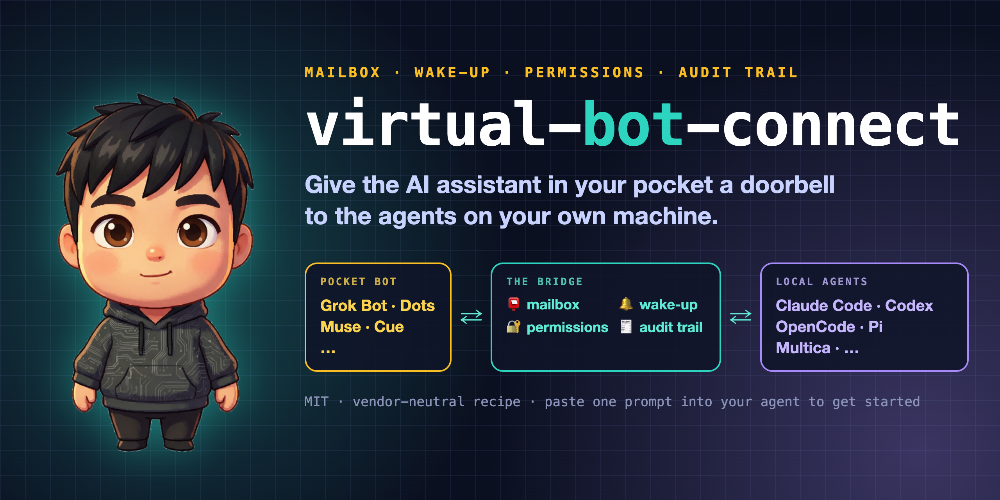
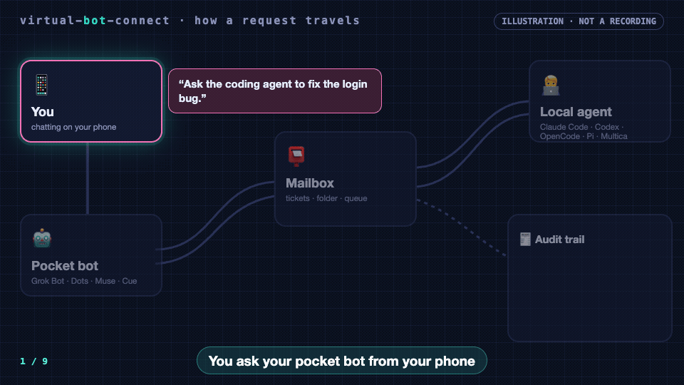
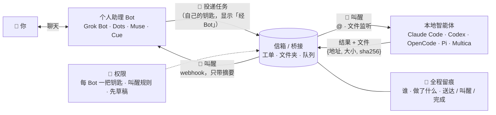

<p align="center">
  
</p>

<p align="center">
  <a href="README.md">English</a> · <b>简体中文</b>
</p>

<p align="center">
  <a href="LICENSE"></a>
  
  
  
  <a href="https://github.com/kkunkunya/virtual-bot-connect/stargazers"></a>
</p>

# virtual-bot-connect · 虚拟助手连接

**给口袋里的 AI 助手，装一个能按响家里智能体的门铃。**

你在手机上跟个人助理 Bot 聊天（Grok Bot、Dots、Muse、Cue……），真正干活的却在自己电脑上：Claude Code、
Codex、OpenCode、Pi，或者 Multica 这样的多智能体体系，仓库和各种登录都在那边。现在两边之间的传话筒是你自己：
复制、粘贴、切窗口、过会儿再回来看。

**virtual-bot-connect 是一套不绑厂商的连接方案，用四个小部件把两边接起来：信箱、叫醒、权限、全程留痕。**
Bot 把活丢进信箱，对口的本地智能体被叫醒去做，结果带着凭证回来，每一步都记在你手机上看得到的地方。

## 直接丢给你的 agent

把下面这段贴进 Claude Code、Codex、OpenCode、Pi，或者任何能读网址的 agent：

```text
Fetch and follow https://raw.githubusercontent.com/kkunkunya/virtual-bot-connect/main/AGENTS.md
to connect me to my personal-assistant bot. First ask me which bot I use and which local agent
setup I run, then propose the smallest setup before changing anything. Never print, paste or
commit any of my keys.
```

想用中文交流，可以在末尾加一句「请用中文和我沟通」。你的 agent 会读完操作手册，先问你几个问题，查清你的 Bot
到底能做什么（有没有命令行、能不能收 webhook、有没有定时任务），再搭一个最小可用的桥。这里没有黑盒安装器，
每一步都是你可以先读一遍的文档。

<p align="center">
  
  <br><sub><i>流程动画示意，不是真实录屏。</i></sub>
</p>

## 四个部件

| | 部件 | 干什么 | 一句话规矩 |
|---|---|---|---|
| 📮 | **信箱 / 桥接** | 两边都能读写的同一个地方：工单系统、共享文件夹、队列。 | 消息**只带指针不带正文**；文件以 `{地址, 大小, sha256}` 传，核对后才用。 |
| 🔔 | **叫醒** | 新消息一到就叫醒收件方（webhook、@、文件监听），不靠大家轮询。 | **收件方决定谁能叫醒自己**：事件类型、每小时上限、夜间静音；轮询只做兜底。 |
| 🔐 | **权限** | 每个 Bot 一把自己的、随时可吊销的钥匙；对外动作要你明确点头。 | 公开发帖、花钱、给第三方发消息一律**先草稿**；钥匙放受保护文件，不进聊天、不进命令参数。 |
| 🧾 | **全程留痕** | 每个请求、叫醒、结果、文件都有记录，并标明是谁做的（「经 &lt;Bot 名&gt;」）。 | **已送达 ≠ 已叫醒 ≠ 已完成**分开记；拿不准就写「不确定」。 |

每个部件的可选做法见 [docs/primitives.md](docs/primitives.md)。

## 整体结构



## 支持情况

方案本身是通用的；目前在真实账号上跑过的只有一种组合，状态如实标注。

| 哪一边 | 工具 | 需要它提供什么 | 状态 |
|---|---|---|---|
| 口袋 Bot | **Grok Bot** | 自带可跑命令的云电脑、可由 webhook 触发的 Routine | ✅ Bot 用 CLI 直连 Multica、Mac 经 SSH 进云电脑已跑通 · 🚧 webhook 即时叫醒真机验收中 —— [例子](examples/kun-mac-multica-grok/) |
| 口袋 Bot | Dots (OpenAI) · Muse (Meta) · Cue (Manus) | 能往信箱写东西（命令行、HTTP 或工具调用），能被叫醒（webhook 或定时） | 🧪 未测 —— [接入清单](docs/adding-a-new-bot.md) |
| 本地智能体 | **Multica** | 工单/聊天当信箱，`@智能体` 当叫醒 | ✅ 已跑通（同一个例子） |
| 本地智能体 | Claude Code · Codex · OpenCode · Pi | 一个能被监听程序拉起的非交互模式（`claude -p`、`codex exec`、`opencode run` 等） | 🧪 做法已写，尚未实测 |

你跑通了别的组合？欢迎提 PR：在 `docs/` 下加一页、在这张表里加一行。见 [CONTRIBUTING.md](CONTRIBUTING.md)。

## 真实例子：一台 Mac + Multica + Grok Bot

[`examples/kun-mac-multica-grok/`](examples/kun-mac-multica-grok/) 是作者自己在用的一套，已脱敏：

- **信箱**：Multica 的工单和聊天；需要在 Bot 云电脑上跑的长任务，走 Mac 端的执行信箱桥接。
- **叫醒**：@ 叫醒家里的智能体；Multica 把事件摘要 POST 到 Grok Bot 的 Routine webhook（服务端已做好，真机验收中）。
- **权限**：带「经 Bot」标记的 Bot 钥匙；收件方自己定叫醒规则（每小时 6 次，23:00–08:00 静音）。
- **留痕**：所有东西都在 Multica 里；结果文件带大小和 sha256。
- **远程主机**：Mac 上的智能体经 Tailscale SSH 进 Bot 的云电脑干活。

## 常见问题

**这是一个要安装的应用吗？**
不是。它是一套方案、一份消息约定和实际例子。你的 agent 读完后，按你的环境搭出需要的那点胶水。例子里用到的桥接脚本和
Multica 服务端改动还没公开（见路线图）。

**和 [Yobiru](https://github.com/chekusu/yobiru) 有什么不同？**
Yobiru 是一个能用的传输层：同一 Tailscale 网络里的智能体互相发消息、传文件、叫醒。本仓库在它上面一层，讲*口袋助手*
怎么把活交给*本地智能体*，以及账本、权限、先草稿这些规矩。我们的叫醒设计借鉴了 Yobiru，你也可以直接拿 Yobiru 当信箱。

**一定要用 Multica 吗？**
不用。例子里用 Multica 当账本，是因为它现成就有工单、聊天、@ 叫醒和审计记录。共享文件夹加一个文件监听程序，或者两边
都能访问的任何队列，也都能当信箱。

**一定要用 Tailscale 吗？**
只有当本地智能体要登录 Bot 的云电脑、把它当远程主机时才需要。信箱和叫醒两条路不依赖它。

**把钥匙交给 Bot 安全吗？**
每个 Bot 一把可以一键吊销的钥匙；它写的东西都标「经 Bot」，永远不算你本人的拍板；对外动作只出草稿；敏感项目从一开始就
不放到 Bot 那边。细节见 [docs/primitives.md](docs/primitives.md#-permissions)。

**我的 Bot 没有命令行，还能接吗？**
有可能。它要有办法往信箱里写东西（HTTP 工具、邮件、连接器），也要有办法被叫醒。先跑一遍[新 Bot 接入清单](docs/adding-a-new-bot.md)，
它会告诉你哪些路走得通。

## 路线图

- [x] 实际例子：Mac + Multica + Grok Bot（CLI 直连、远程主机、执行信箱）
- [x] 四个部件的通用写法
- [ ] Multica → Grok Bot 叫醒 webhook 的真机验收
- [ ] 最小的「文件夹信箱 + 监听程序」，叫醒 Claude Code / Codex / OpenCode，并真机跑通一次
- [ ] Dots、Muse、Cue 的实测接入页
- [ ] 公开 Mac 端桥接脚本（脱敏）
- [ ] 把 Yobiru 作为可直接替换的信箱传输层

## 仓库结构

```text
README.md · README.zh-CN.md   概览（英文 / 中文）
AGENTS.md                     给 agent 照着做的接入手册
llms.txt                      给大模型的索引
docs/
  primitives.md               信箱 · 叫醒 · 权限 · 留痕，各自的可选做法
  adding-a-new-bot.md         接入任何新 Bot / 新平台的清单
examples/
  kun-mac-multica-grok/       作者的真实配置：Multica + Grok Bot + Tailscale
research/
  benchmark.md                向 Yobiru、baoyu-skills、Superpowers、anthropics/skills 借鉴了什么
  yobiru.md · yobiru.zh-CN.md Yobiru 叫醒设计的对照笔记
```

## 致谢

- 郭宇（[@turingou](https://x.com/turingou)）的 **[Yobiru](https://github.com/chekusu/yobiru)**：收件方定叫醒规则、小消息只指向内容、
  文件按 sha256 核对、「送达 / 叫醒 / 完成」分开。对照笔记：[research/yobiru.zh-CN.md](research/yobiru.zh-CN.md)。
- README 结构借鉴了 [Superpowers](https://github.com/obra/superpowers)（「fetch and follow」一句话上手）、
  [baoyu-skills](https://github.com/JimLiu/baoyu-skills)（让 agent 帮你装、star 曲线、语言切换）、
  [Yobiru](https://github.com/chekusu/yobiru)（标明是示意的概念图、如实写状态）和
  [anthropics/skills](https://github.com/anthropics/skills)（按使用场景列支持情况）。完整对比：[research/benchmark.md](research/benchmark.md)。
- 感谢 [Multica](https://github.com/multica-ai/multica) 与 [Tailscale](https://tailscale.com)。

文中产品名归各自所有者，列出不代表背书。

## Star 曲线

<a href="https://star-history.com/#kkunkunya/virtual-bot-connect&Date">
  
</a>

## 许可

[MIT](LICENSE)
