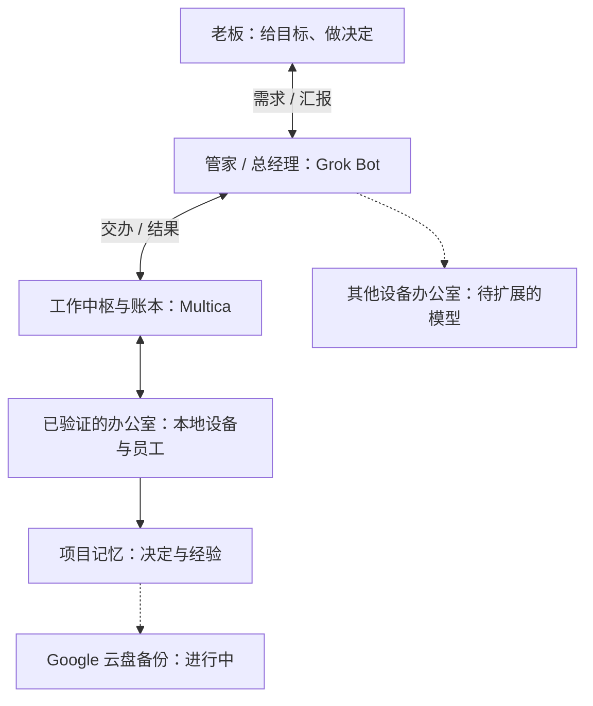
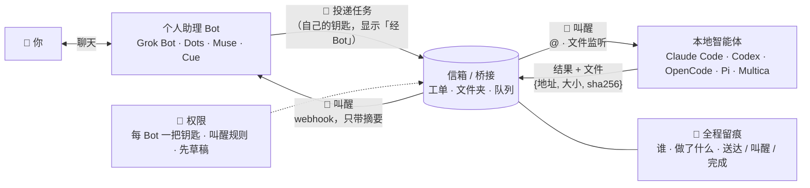

<p align="center">
  <a href="README.md">English</a> · <b>简体中文</b>
</p>

<p align="center">
  <a href="LICENSE"></a>
  
  
  <a href="https://github.com/kkunkunya/virtual-bot-connect/stargazers"></a>
</p>

# virtual-bot-connect · Kun 的办公室

**我想让私人管家联络每台设备上的办公室，把员工做事留下的记忆留住，让自己的精力回到需要我做的决定上。**

一台电脑里有很多 agent，设备一多，任务到了以后怎么排序、谁来跟进，还是要我盯着每条线程。
从第一性原理来讲，我的精力和大脑 I/O 都有上限。我觉得，对程序员、身兼数职的人来说，需要有一个总经理帮忙协调、汇总，再来汇报。

这里放的是我的解法：先把设备和私人管家连起来，一台设备当一个办公室，再把员工做事留下的记忆留住。
仓库里有这套思路、消息约定和脱敏后的例子。大家可以先看我怎么分工，再考虑自己的环境要怎么接。

## 1. 组网与私人管家

Grok Bot 提供一台虚拟机电脑，我通过 Tailscale 把它和自己的设备连成一个私人网络，参考的是郭宇老师的
[Yobiru](https://github.com/chekusu/yobiru)。我在手机上跟管家说需求，它去联络办公室，收集结果以后再报给我。

目前只验证过 **Grok Bot + Multica**。以后可以考虑换成 Muse、Dots 或 Cue，但这些接法**未测**，要先确认各自的能力。

## 2. 一台设备，就是一个办公室

每台设备是一个**办公室**，里面干活的 agent 是**员工**。已验证的例子里，Multica 是工作中枢和账本，负责派活、记录任务、聊天和结果；
管家负责联络办公室、跟进，再汇总给我这个老板。

我给目标、做需要我拍板的决定，不想直接管每台设备、每条线程。我的判断是，看板、多 agent 和远程 App 仍然把协调这件事留给了人，
所以我希望私人 agent 能当总经理，把这部分接过去。



虚线表示准备扩展的方向与在建的备份，不代表新增了已验证的部署。详见[办公室模型](docs/office-model.zh-CN.md)。

## 3. 员工留下的记忆，是我想保住的资产

员工干完一件事，把有用的决定和经验留进项目记忆，下一位员工就能接着做。
对我来说，塔罗、toB、自媒体、学校这些方向积累下来的东西，都是核心资产，我希望换设备、换管家以后也能继续用。

**自动备份到 Google 云盘还在进行中**：计划 Grok Bot 每 **2 天**一次、Multica 每 **7 天**一次。
这两个周期和恢复过程尚未验收通过。「换办公室、换总经理，整套仍能转」是这套方案要达到的目标，不能写成已经验证过的恢复能力。
详见[记忆与备份状态](docs/office-model.zh-CN.md#记忆与备份状态)。

## 办公室下面怎么接线

管家和员工之间要有信箱、叫醒、权限和全程留痕。它们是办公室之间的连接部件，下面把已跑通的通路和未测的接法分开写。

<p align="center">
  
  <br><sub>连接部件的概念示意，不是部署截图。</sub>
</p>

<p align="center">
  
  <br><sub><i>流程动画示意，不是真实录屏。</i></sub>
</p>

## 四个部件

| | 部件 | 干什么 | 一句话规矩 |
|---|---|---|---|
| 📮 | **信箱 / 桥接** | 两边都能读写的同一个地方：工单系统、共享文件夹、队列。 | 消息**只带指针不带正文**；文件以 `{地址, 大小, sha256}` 传，核对后才用。 |
| 🔔 | **叫醒** | 新消息一到就叫醒收件方（webhook、@、文件监听），不靠大家轮询。 | **收件方决定谁能叫醒自己**：事件类型、每小时上限、夜间静音；轮询只做兜底。 |
| 🔐 | **权限** | 每个 Bot 一把自己的、随时可吊销的钥匙；对外动作要你明确点头。 | 公开发帖、花钱、给第三方发消息一律**先草稿**；钥匙放受保护文件，不进聊天、不进命令参数。 |
| 🧾 | **全程留痕** | 每个请求、叫醒、结果、文件都有记录，并标明是谁做的（「经 &lt;Bot 名&gt;」）。 | **已送达 ≠ 已叫醒 ≠ 已完成**分开记；拿不准就写「不确定」。 |

每个部件的可选做法见 [docs/primitives.md](docs/primitives.md)。

## 连接部件的结构

这是通用流程示意。只验证过 Grok Bot + Multica；webhook 回传叫醒仍在实测，其他接法未测。



## 已验证、在测与未测

方案本身是通用的；目前在真实账号上跑过的只有一种组合，状态如实标注。

| 哪一边 | 工具 | 需要它提供什么 | 状态 |
|---|---|---|---|
| 口袋 Bot | **Grok Bot** | 自带可跑命令的云电脑、可由 webhook 触发的 Routine | ✅ Bot 用 CLI 直连 Multica、Mac 经 SSH 进云电脑已跑通 · 🚧 webhook 即时叫醒真机验收中 · [例子](examples/kun-mac-multica-grok/) |
| 口袋 Bot | Dots (OpenAI) · Muse (Meta) · Cue (Manus) | 能往信箱写东西（命令行、HTTP 或工具调用），能被叫醒（webhook 或定时） | 🧪 未测 · [接入清单](docs/adding-a-new-bot.md) |
| 本地智能体 | **Multica** | 工单/聊天当信箱，`@智能体` 当叫醒 | ✅ 已跑通（同一个例子） |
| 本地智能体 | Claude Code · Codex · OpenCode · Pi | 一个能被监听程序拉起的非交互模式（`claude -p`、`codex exec`、`opencode run` 等） | 🧪 做法已写，尚未实测 |

你跑通了别的组合？欢迎提 PR：在 `docs/` 下加一页、在这张表里加一行。见 [CONTRIBUTING.md](CONTRIBUTING.md)。

## 已验证的办公室例子：一台 Mac + Multica + Grok Bot

[`examples/kun-mac-multica-grok/`](examples/kun-mac-multica-grok/) 是作者自己在用的一套，已脱敏：

- **信箱**：Multica 的工单和聊天；需要在 Bot 云电脑上跑的长任务，走 Mac 端的执行信箱桥接。
- **叫醒**：@ 叫醒家里的智能体；Multica 把事件摘要 POST 到 Grok Bot 的 Routine webhook（服务端已做好，真机验收中）。
- **权限**：带「经 Bot」标记的 Bot 钥匙；收件方自己定叫醒规则（每小时 6 次，23:00–08:00 静音）。
- **留痕**：所有东西都在 Multica 里；结果文件带大小和 sha256。
- **远程主机**：Mac 上的智能体经 Tailscale SSH 进 Bot 的云电脑干活。

## 实战经验

- **分工**：私人 Bot 是管家，负责协调、跟进，并按你定的规矩验收和合并；多 agent 平台负责派活和沉淀。有风险的事才找人。
- **推送接入的坑**：`Authorization` 字段的值要写成 `Bearer <token>`；静音时段按主人所在时区设；每小时上限设太低会把真事件拦住或拖后。
- **叫醒上限要讲理**：被拦下明确报错，人发的消息不受限，同一张单的唤醒合并，叫停一件事时相关的一起停。
- **换钥匙**：删之前先确认谁在用；钥匙失效就自动离线、改派并通知你。
- **巡检与记忆**：看有没有重复或卡住，把决定和经验留进项目记忆。Google 云盘自动备份进行中：Grok Bot 每 2 天、Multica 每 7 天；恢复未验收。
- **带图的结果一律做成手机网页交付。**

详见 [docs/lessons-learned.zh-CN.md](docs/lessons-learned.zh-CN.md)

## 常见问题

**这是一个要安装的应用吗？**
它是一套方案、一份消息约定和实际例子。你的 agent 读完后，按你的环境搭出需要的那点胶水。例子里用到的桥接脚本和
Multica 服务端改动还没公开（见路线图）。

**和 [Yobiru](https://github.com/chekusu/yobiru) 有什么不同？**
Yobiru 是一个能用的传输层：同一 Tailscale 网络里的智能体互相发消息、传文件、叫醒。本仓库讲我的办公室模型：管家联络各台设备，
Multica 留下工作记录，项目记忆希望能在换工具以后接着用；连接部件里保留账本、权限、先草稿这些规矩。我们的叫醒设计借鉴了 Yobiru。
也可以评估用 Yobiru 作为信箱传输层，但这个接法在本方案里尚未实测。

**一定要用 Multica 吗？**
例子里用 Multica 当账本，是因为它现成就有工单、聊天、@ 叫醒和审计记录。共享文件夹加文件监听程序，或者两边
都能访问的队列，是可考虑的替代方案，这些接法在本仓库尚未实测。

**一定要用 Tailscale 吗？**
我的办公室方案用 Tailscale 连接设备和 Bot 的云电脑；自己的环境也可以评估别的私人网络。
单独设计信箱或 webhook 可以不依赖这个网络，但那不等于复现了整套办公室方案，其他部署也尚未实测。

**把钥匙交给 Bot 安全吗？**
每个 Bot 一把可以一键吊销的钥匙；它写的东西都标「经 Bot」，永远不算你本人的拍板；对外动作只出草稿；敏感项目从一开始就
不放到 Bot 那边。细节见 [docs/primitives.md](docs/primitives.md#-permissions)。

**我的 Bot 没有命令行，还能接吗？**
要接入，它要有办法往信箱里写东西（HTTP 工具、邮件、连接器），也要有办法被叫醒。先跑一遍[新 Bot 接入清单](docs/adding-a-new-bot.md)，
它会告诉你哪些路走得通。

## 路线图

- [x] 实际例子：Mac + Multica + Grok Bot（CLI 直连、远程主机、执行信箱）
- [x] 四个部件的通用写法
- [ ] Google 云盘自动备份：Grok Bot 每 2 天、Multica 每 7 天（进行中，恢复未验收）
- [ ] Multica → Grok Bot 叫醒 webhook 的真机验收
- [ ] 最小的「文件夹信箱 + 监听程序」，叫醒 Claude Code / Codex / OpenCode，并真机跑通一次
- [ ] Dots、Muse、Cue 的实测接入页
- [ ] 公开 Mac 端桥接脚本（脱敏）
- [ ] 把 Yobiru 作为可直接替换的信箱传输层

## 按自己的环境改方案（可选）

读完办公室模型后，可以让 agent 先评估自己的环境。其他本地 agent 的接入仍未测，下面这段用于出方案。

```text
Fetch and follow https://raw.githubusercontent.com/kkunkunya/virtual-bot-connect/main/AGENTS.md
and https://raw.githubusercontent.com/kkunkunya/virtual-bot-connect/main/docs/office-model.zh-CN.md
to plan a butler and device offices for my own setup. First ask me which bot I use and which local agent
setup I run, then propose the smallest setup before changing anything. Never print, paste or
commit any of my keys.
```

想用中文交流，可以在末尾加一句「请用中文和我沟通」。你的 agent 会读完操作手册，先问你几个问题，查清你的 Bot
到底能做什么（有没有命令行、能不能收 webhook、有没有定时任务），再搭一个最小可用的桥。这里没有黑盒安装器，
每一步都是你可以先读一遍的文档。

## 仓库结构

```text
README.md · README.zh-CN.md   办公室模型与验证状态（英文 / 中文）
AGENTS.md                     办公室口径、维护规矩与可选接入手册
llms.txt                      给大模型的索引
docs/
  office-model*.md            管家、设备办公室、记忆与备份状态（英文 / 中文）
  primitives.md               信箱 · 叫醒 · 权限 · 留痕，各自的可选做法
  adding-a-new-bot.md         接入任何新 Bot / 新平台的清单
  lessons-learned.zh-CN.md    实战经验：分工、推送、叫醒上限、换钥匙、巡检、项目记忆与在建备份
examples/
  kun-mac-multica-grok/       作者的真实配置：Multica + Grok Bot + Tailscale
research/
  benchmark.md                向 Yobiru、baoyu-skills、Superpowers、anthropics/skills 借鉴了什么
  yobiru.md · yobiru.zh-CN.md Yobiru 叫醒设计的对照笔记
```

## 致谢

- 郭宇（[@turingou](https://x.com/turingou)）的 **[Yobiru](https://github.com/chekusu/yobiru)**：收件方定叫醒规则、小消息只指向内容、
  文件按 sha256 核对、「送达 / 叫醒 / 完成」分开。对照笔记：[research/yobiru.zh-CN.md](research/yobiru.zh-CN.md)。
- README 结构借鉴了 [Superpowers](https://github.com/obra/superpowers)（「fetch and follow」一句话上手）、
  [baoyu-skills](https://github.com/JimLiu/baoyu-skills)（让 agent 帮你装、star 曲线、语言切换）、
  [Yobiru](https://github.com/chekusu/yobiru)（标明是示意的概念图、如实写状态）和
  [anthropics/skills](https://github.com/anthropics/skills)（按使用场景列支持情况）。完整对比：[research/benchmark.md](research/benchmark.md)。
- 感谢 [Multica](https://github.com/multica-ai/multica) 与 [Tailscale](https://tailscale.com)。

文中产品名归各自所有者，列出不代表背书。

## Star 曲线

<a href="https://star-history.com/#kkunkunya/virtual-bot-connect&Date">
  
</a>

## 紧凑读取活动

[Fast-access v1 协议](docs/fast-access-protocol.md)和
[Python/SQLite 示例](examples/fast-access-client/)演示紧凑读取、事件提醒与崩溃后恢复摘要缓存。
假数据演示无需账号、凭据或额外依赖；真实部署的兼容性仍需单独验证。

## 许可

[MIT](LICENSE)
