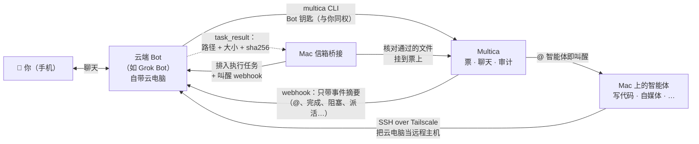

# virtual-bot-connect · 虚拟助手连接

**让云端聊天 Bot 和家里的 AI 智能体互相说话、互相叫醒。**

[English](README.md) · MIT 许可 · 设计说明 + 脱敏示例

你在手机上跟云端 Bot（例如 Grok Bot）说话；真正干活的是家里的 [Multica](https://github.com/multica-ai/multica)，
Mac 上的写代码、做内容的智能体都在那边，登着各种账号。这个仓库讲怎么把两边接起来：

- **Bot 当前台**：直接读写 Multica（票、聊天、文件），@ 对应方向的家里智能体；
- **Bot 的云电脑当远程主机**：Mac 上的智能体经 Tailscale SSH 进去跑活；
- **有事即时叫醒对方**（webhook），不靠大家每 30 分钟巡检一次。

叫醒的设计大量借鉴了郭宇的 [Yobiru](https://github.com/chekusu/yobiru)，见文末[致谢](#致谢)。

> **状态**：在一个真实账号上跑通，以文档形式分享。桥接脚本和 Multica 服务端改动在其他仓库，暂未公开。
> 示例里的字段名仅作示意，请以你自己的版本为准。

## 整体结构

| 谁 → 谁 | 触发 | 走哪条路 |
|---|---|---|
| 你 → Bot | 你发消息 | Bot 自己的聊天应用 |
| Bot → 家里智能体 | Bot 在 Multica 票或聊天里 @ 智能体 | Bot 钥匙 + `multica` CLI |
| Multica → Bot | Bot 订阅的事件（@、派活、完成、阻塞、需要你拍板…） | 服务端 POST Bot 的 routine webhook |
| Mac → 云电脑 | 智能体要一台远程机器 | `ssh <bot-host>` 经 Tailscale |
| Multica → 云电脑（执行任务） | 长任务要在云电脑上跑 | 信箱桥接 + 叫醒 webhook |
| （兜底） | 漏掉、被限流或静音的事件 | Bot routine 每 30 分钟巡检 |

## 核心规矩

1. **Multica 是账本**：票、聊天、状态、文件都在这里，手机上能看全局。Bot 是 Multica 的客户端，不另起一套。
2. **Bot 拿真钥匙**：管理员添加的 Bot 拿到与本人同权、带 Bot 标记的钥匙；用它写的内容显示为「经 <Bot 名>」，
   不会被当成你本人的原话，也就不会替你拍板。
3. **收件方决定谁能叫醒自己**：每个 Bot 自己定哪些事件能叫醒、每小时上限（默认 6）、夜间静音（默认 23:00–08:00）。
   被限流的事件留到下次巡检，不丢。
4. **消息只带指针**：叫醒只说「发生了什么、在哪」，Bot 用自己的身份去拉正文；文件以 `{地址, 大小, sha256}` 传，核对后才用。
5. **已送达 ≠ 已叫醒 ≠ 有结果**：汇报分开说，拿不准就写「不确定」，不确定的写操作不盲目重发。
6. **对外动作先草稿**：公开发帖、给第三方发消息、下单，要你明确说「发」；Multica 内部协作不受此限。

## 怎么复用

前置条件：一个你是管理员的 Multica 工作区和 `multica` CLI；一个自带可跑命令电脑的云端 Bot；
（可选）两台机器都装 Tailscale；（可选）Bot 能接收 webhook。

1. **给 Bot 发钥匙**，不要贴在聊天或提示词里，走受保护文件或标准输入。→ [docs/multica-integration.md](docs/multica-integration.md)
2. **在 Bot 电脑装 CLI 并登录**，新开一个 shell 验证登录能持久。
3. **给 Bot 长期指令**：方向路由、汇报格式、先草稿规矩、收到叫醒怎么办。→ [examples/standing-instructions.md](examples/standing-instructions.md)
4. **接上叫醒**：把 Bot 的 webhook 地址和 key 只写不回显地登记到 Multica，再设叫醒规则。→ [examples/webhook/](examples/webhook/)
5. **（可选）远程主机**：云电脑入 tailnet，sshd 开高位端口只认公钥，加守护脚本。→ [docs/grok.md](docs/grok.md)
6. **（可选）执行信箱**：长任务、结果文件带 sha256 核对。→ [examples/mailbox/](examples/mailbox/)
7. **每条通路真机来回跑一次**，并写清哪些没测。

以后再接新 Bot：[docs/adding-a-new-bot.md](docs/adding-a-new-bot.md)。

## 致谢

「智能体互相叫醒」的思路——收件方定叫醒规则、小消息只指向内容、文件按 sha256 自取自核、
「送达 / 叫醒 / 完成」分开——来自 **郭宇（[@turingou](https://x.com/turingou)）** 的开源项目
**[Yobiru](https://github.com/chekusu/yobiru)**（[发布帖](https://x.com/turingou/status/2109153922267107458)）。
推荐读它的 `SPEC.md`。我们的对照笔记：[research/yobiru.zh-CN.md](research/yobiru.zh-CN.md)。

也感谢 [Multica](https://github.com/multica-ai/multica) 与 [Tailscale](https://tailscale.com)。

## 许可

[MIT](LICENSE)
