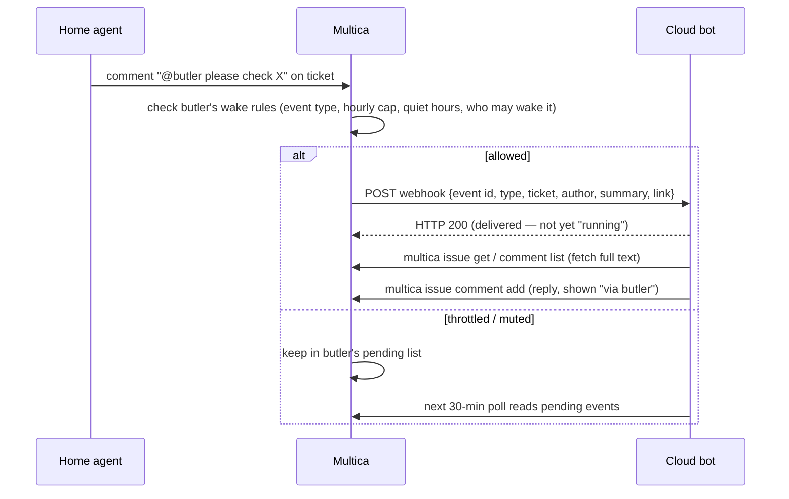

# Architecture

## Roles

- **Multica = the household manager.** All the real agents run here, on your own machine, with your logins.
  It also keeps the record: tickets, chats, state, audit.
- **Cloud bots = front desk + spare computer.** You can have several (e.g. "Workspace butler", "Personal
  errands"). You talk to them while you are out; anything that needs home work goes into Multica, to the agent
  in charge of that area.
- **Remote.** The bot's computer is in the cloud, not on your Mac. The Mac reaches it over Tailscale.

## Channels

| Channel | Direction | How | Notes |
|---|---|---|---|
| Direct CLI | Bot → Multica | `multica` CLI on the bot's computer, logged in with a bot key | read/search tickets and chats, comment, @ agents, update, upload files |
| Wake webhook | Multica → Bot | server POSTs the bot's routine webhook on subscribed events | summary only; the bot fetches details with the CLI |
| Remote host | Mac → Bot computer | `ssh <bot-host>` over Tailscale | sync a repo, run tests, fetch results |
| Execution mailbox | Multica → Bot computer → Multica | Mac bridge writes a task into the bot's inbox, bot replies with `task_result` | for long jobs; result files verified by size + sha256 |
| Polling | Bot → Multica | bot routine every 30 min | fallback only: picks up throttled, muted or failed wake-ups |

## Ground rules

1. **Full rights, no tiers.** A bot added by an admin gets the admin's rights. Server-side permission checks still
   apply; there is no extra "confirm before delete" layer for bots.
2. **Drafts first for anything outward.** Public posts, messages to third parties, purchases: show a draft, wait
   for an explicit "send".
3. **Route by area, not by agent.** The bot only decides *which area* a request belongs to (coding, content,
   …). Which agent handles that area is a lookup table on the Multica side that you can change.
4. **Reply to whoever asked.** Messages carry `from_bot`; replies go back to the bot that started the thread.
5. **Keep sensitive projects off the cloud.** Decide up front which projects never go to bots.
6. **Credentials are registered, never written down.** Whatever credentials sit on the bot computer are listed
   (purpose + how to revoke, no values) in a registry file there. All bots on one account share that computer,
   so a key there *is* your identity — revoke it from the settings page if anything goes wrong.
7. **Report in detail.** Who, which ticket or chat, what was done, result and evidence, next step. Mark what was
   not read, not finished or still queued.
8. **Events wake, polling backs up** (borrowed from Yobiru): mentions both ways, webhook wake-ups, the receiver
   owns its wake rules, files as address + sha256.
