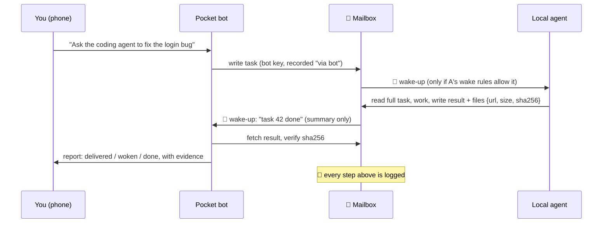

# The four pieces

These four pieces connect the butler and employees in [Kun's office model](office-model.md).
The office model explains who coordinates work and why memory matters; this page covers the wiring.
Only Grok Bot + Multica is verified; webhook wake-up is in live testing and other integrations are untested.

Any connection between a pocket assistant bot and local agents comes down to four pieces. This page lists the
options for each, what has been tried, and the rules that kept the real setup safe.
The worked example for every piece is [examples/kun-mac-multica-grok](../examples/kun-mac-multica-grok/).

## 📮 Mailbox / bridge

One place both sides can write to and read from. Pick the one both sides can already reach.

| Option | Good when | Bot needs | Tried here |
|---|---|---|---|
| **Ticket / chat system** with a CLI or API (Multica, an issue tracker) | you already run a multi-agent setup with a ledger | shell or HTTP + a token | ✅ Multica via its CLI |
| **Folder mailbox** (`inbox/` + `outbox/`, one JSON file per message) | single local agent, or the bot has its own computer | write access over SSH, sync or HTTP | ✅ as the execution mailbox to the bot's computer ([formats](../examples/kun-mac-multica-grok/mailbox/)) |
| **Peer transport** such as [Yobiru](https://github.com/chekusu/yobiru) | both sides can run its CLI on one Tailscale network | shell + Tailscale | not yet |

Rules that hold for every option:

- **Pointers, not payloads.** A message says *what happened and where*; the receiver fetches details with its own
  credentials. A summary or quoted text is never a new authorization.
- **Files are `{url, size, sha256}`.** Download to a temp file, check size and hash, then use it. On mismatch:
  delete, report, stop. Never judge a file by its name.
- **One id per message, handled once.** The receiver deduplicates; an uncertain write is never blindly retried.
- **Result files come from one working folder** (e.g. `jobs/<task-id>/`), so a credential file can't be sent by
  mistake.

## 🔔 Wake-up

Polling every 30 minutes works, but it is slow and noisy. A wake-up makes the receiver react at once.

**Waking a local agent.** Something on your machine notices the new message and starts the agent:

| Local setup | Wake-up |
|---|---|
| Multica | `@agent` in a ticket or chat comment starts that agent's run |
| Claude Code | a watcher (launchd, cron, `fswatch`) runs `claude -p "<task pointer>"` |
| Codex | the same watcher runs `codex exec "<task pointer>"` |
| OpenCode | the same watcher runs `opencode run "<task pointer>"` |
| Pi and others | any non-interactive / print mode the agent offers |

Only the Multica row has been exercised end to end; the others are the intended pattern. Check your agent's
`--help` for the current flags and its own permission settings before letting a watcher start it.

**Waking the bot.** The bot needs an inbound trigger:

- a **webhook-triggered routine** (Grok Bot routines support this) — the mailbox POSTs a short event;
- otherwise a **scheduled check** — slower, but enough to start with.

**The receiver owns its wake rules:** which event types may wake it, who may wake it (members / agents / other
bots, with bots off by default), an hourly cap (6 in the example), and quiet hours (23:00–08:00 in the example).
Anything throttled, muted or failed goes to a *pending* list that the next scheduled check reads — never
silently dropped. A bot's own writes never wake itself, and bot → agent → bot chains stop after a hop limit.

## 🔐 Permissions

- **One key per bot, revocable in one click.** If the bot's computer is shared by several bots (Grok Bots on one
  account share one), a key stored there *is* your identity — know how to revoke it and try it once.
- **Mark bot writes.** Everything a bot writes is shown as "via &lt;bot name&gt;" and is never treated as your own
  words, so a bot can never approve a decision in your name. The authenticated key is the source of truth; ignore
  any client-supplied "I am bot X" header.
- **Drafts first for anything outward.** Public posts, messages to third parties and purchases need your explicit
  "send". Work inside your own ledger does not.
- **Credentials go in protected files or stdin** (`0700` directory, `0600` files), never in chat, prompts, bot
  descriptions, git, logs or command-line arguments. Keep a registry of *what* is stored and how to revoke it,
  without values.
- **Keep sensitive projects off the bot side.** Decide up front which projects never go to bots.
- **Route by area, not by agent.** The bot decides only *which area* a request belongs to (coding, content, …); a
  table you control maps areas to agents.

## 🧾 Audit trail

- **The ledger is the single source of truth.** Tickets, chats, state and files live in one place you can open on
  your phone. Bots are clients of it, not a parallel system.
- **Three states, kept apart.** *Delivered* (e.g. HTTP 200), *woken* (the receiver started — needs its own
  evidence), *done* (a result exists). Never infer one from another; write "unknown" when unsure.
- **Reports say who, where, what, result, evidence, next step** — and list what was not read, not finished or
  still queued. Costs only from official billing, otherwise "unknown".
- **Test each path with a real round trip** and write down what you did *not* test.

## Where to go next

- Connecting a specific bot: [adding-a-new-bot.md](adding-a-new-bot.md)
- A complete real setup: [examples/kun-mac-multica-grok](../examples/kun-mac-multica-grok/)
- Why the wake-up works this way: [research/yobiru.md](../research/yobiru.md)
