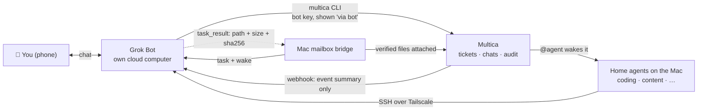

# Example: a Mac, Multica and Grok Bots

The author's verified local office and cloud-butler example, sanitized. See [Kun's office model](../../docs/office-model.md)
for the role split and memory goal. Wider multi-office deployments are not implied by this example. Automatic
Google Drive backups are in progress (Grok Bot every 2 days, Multica every 7 days); recovery is unverified.

The author's own setup, sanitized. Host names, addresses and keys are placeholders. Some Multica features used
here (an *External bots* settings page, "via bot" attribution, wake rules) were built in a Multica fork for this
project and may not be in upstream Multica; with plain upstream you can still use a personal API token and the CLI.

## The four pieces in this setup

| Piece | How it is done here | Status |
|---|---|---|
| 📮 Mailbox | Multica tickets and chats; a Mac-side bridge writes long jobs into the bot computer's `inbox/` and collects `task_result` | ✅ CLI path verified on a real account; bridge delivered a real task |
| 🔔 Wake-up | `@agent` wakes home agents; Multica POSTs a short event to the Grok Bot's routine webhook; a 30-minute routine is the backstop | ✅ `@agent` · 🚧 webhook built server-side, live acceptance in progress |
| 🔐 Permissions | per-bot key with the admin's rights, marked as a bot key; writes shown "via &lt;bot&gt;"; receiver-owned wake rules; drafts first | ✅ |
| 🧾 Audit trail | everything lives in Multica; result files carry size + sha256 | ✅ |
| ➕ Remote host | Mac agents SSH into the bot's cloud computer over Tailscale (plain `sshd`, high port, keys only, watchdog) | ✅ |

## Files

| File | What |
|---|---|
| [architecture.md](architecture.md) | roles, channels, ground rules |
| [multica-integration.md](multica-integration.md) | bot keys, "via bot" attribution, CLI cheat sheet, wake rules |
| [grok.md](grok.md) | Grok Bot specifics: shared cloud computer, Tailscale + SSH, watchdog, pitfalls |
| [standing-instructions.md](standing-instructions.md) | long-lived instructions pasted into the bot |
| [webhook/](webhook/) | wake event payload, HTTP request, wake rules |
| [mailbox/](mailbox/) | execution task / result formats |
| [ssh/](ssh/) | `ssh_config` and watchdog sketch |

## Step by step

1. **Give the bot a key** through a protected file or stdin, never chat. → [multica-integration.md](multica-integration.md)
2. **Install the `multica` CLI on the bot's computer** and check login from a fresh shell.
3. **Paste the standing instructions**: routing by area, reporting style, drafts first, wake handling.
   → [standing-instructions.md](standing-instructions.md)
4. **Wire wake-ups**: register the bot's webhook with Multica (stored write-only), set wake rules. → [webhook/](webhook/)
5. **Optional, remote host**: join the bot computer to your tailnet, `sshd` on a high port, keys only, watchdog.
   → [grok.md](grok.md), [ssh/](ssh/)
6. **Optional, execution mailbox** for long jobs with verified result files. → [mailbox/](mailbox/)
7. **Test each path with a real round trip** and write down what you did not test.

Field names in the JSON examples are illustrative; check them against your own versions.
