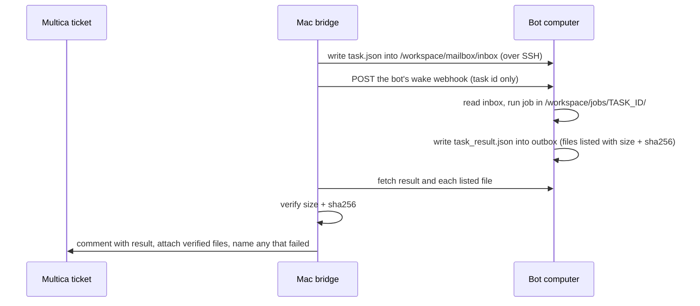

# Execution mailbox

For jobs that must run on the bot's computer and report back with files. Everything else (reading tickets,
chatting, commenting) goes through the CLI directly.

- One JSON file per message. [`task.json`](task.json) goes to the bot, [`task_result.json`](task_result.json)
  comes back.
- `to` addresses one bot when several share a computer; without it, the first bot to read takes it.
- Only task ids the bridge issued are accepted, each reported once.
- Result files must live under `/workspace/jobs/<task-id>/` (anything else is rejected, so a token file can't be
  sent by mistake). Defaults: 25 MB per file, 10 files per result.
- The wake webhook carries only the task id. If waking fails, delivery still stands; the scheduled check picks
  it up.
- With no open tasks the bridge connects only every 15 minutes, to cut SSH noise.
