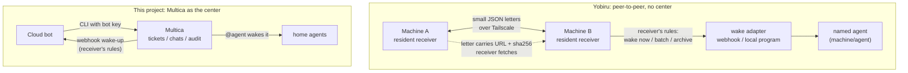

# What we learned from Yobiru

[Yobiru](https://github.com/chekusu/yobiru) by Guo Yu ([@turingou](https://x.com/turingou),
[announcement](https://x.com/turingou/status/2109153922267107458)) is a small, open-source **messaging layer
that lets agents on different machines wake each other up**. We read version 0.3.0 (commit `422f40e`). Its
predecessor was called *tailmsg*; the protocol document `SPEC.md` (in Chinese) is the part most worth reading.

Original notes in Chinese: [yobiru.zh-CN.md](yobiru.zh-CN.md).

## Yobiru in one paragraph

Every machine runs a tiny resident receiver. Letters go directly between machines over Tailscale. Files don't
travel inside letters: the receiver fetches them from the sender and checks size and sha256. **The receiver
decides who may wake it and when** — the sender can only *request* a wake level. It deliberately does not do
task tracking: no queue, no "done", no read receipts.

## First conclusion: borrow five ideas, keep Multica

Why not replace everything with Yobiru at first:

1. It deliberately doesn't track tasks — but we need "who is doing which ticket, how far along" on a phone.
2. The bot → home direction was already shorter: the bot writes to Multica with the CLI and @-mentions wake agents.
3. A Mac running Tailscale in userspace mode can't host a receiver on a tailnet address.
4. Its own README said the Grok Bot end-to-end path still needed testing on a real account.

The five ideas, by payoff:

| # | Idea | How Yobiru does it | What we did |
|---|---|---|---|
| 1 | **Wake the bot with its webhook** | the wake adapter POSTs the bot routine's webhook with a bearer key; 200 = routine started | Multica (and the mailbox bridge) POST the bot's routine webhook; polling becomes the fallback |
| 2 | **Receiver owns wake rules** | sender requests `now / batch / none`; receiver applies caps, quiet hours, per-hour limits — only ever downgrading | per-bot event types, hourly cap, quiet hours, who-may-wake; throttled events go to *pending* |
| 3 | **Files as URL + size + sha256** | download to `.part`, verify, rename; mismatch = delete + error | attachments and mailbox results carry size + sha256 and are verified before use |
| 4 | **Delivered / woken / done are different** | 202 = accepted; webhook OK = woken; a reply = done; uncertain sends are never auto-resent | bot instructions and reports use the same three states and say "unknown" when unsure |
| 5 | **One read-only health check** | `onboard` / `doctor` tell you where it's stuck and who must act | planned: a `doctor` for the bot computer to run before connecting a new bot |

Deliberately not borrowed:

- **Sender identity from Tailscale.** All our bots share one computer and one key, so `from_bot` is for routing,
  not security. (Yobiru says the same of `from_agent`: "names are for routing, not isolation.") Real
  attribution comes from the server recognising the bot key ("via bot").
- **Binding agents to session ids.** Multica chats already have session ids.

## Decision afterwards: follow Yobiru's model for the whole link

After the first review, the owner decided to adopt Yobiru's model end to end, with Multica still keeping the
record:

- both sides can @-mention each other (bots appear in Multica's mention list);
- events wake the other side immediately — the Multica server POSTs the bot's webhook directly, not via the Mac;
- the receiver decides who may wake it;
- files are passed as address + sha256 and the receiver fetches them;
- polling only as a backstop.

What still differs from Yobiru: there is a center (Multica), because seeing all work in one place from a phone
is the point.

## Shared principles

- A message is a request, never an approval. (Yobiru: "a message is never an approval"; here: outward actions
  are drafts until the owner says "send".)
- Data stays on its own machine; credentials never go into message bodies.
- You can address a specific agent (`machine/agent` ↔ @agent in Multica).

## Where plain Yobiru would still fit

If a bot needs to talk directly to agents that are *not* in Multica (say a coding agent on another server),
Yobiru could run on the bot's computer (it has `sudo` and TUN) as a side channel, with Multica staying the center.
