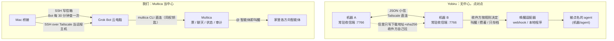

# 对照研究：郭宇的 Yobiru（2026-10-11）

> **2026-10-11 更新：Kun 拍板整体照 Yobiru 思路做**——互相 @、事件即时叫醒、收件方定叫醒规则、文件只传地址+sha256、叫醒链路不经中转。落地方案：Multica 服务端在事件发生时直接 POST Grok routine webhook，外部 Bot 可被 @，每个 Bot 有自己的叫醒规则（事件类型 / 每小时上限 / 夜间静音，只降不升）。Multica 仍负责记账（票、聊天、审计）。下文“不整体替换、只借五点”是拍板前的初版结论，保留作对照。

- 仓库：https://github.com/chekusu/yobiru （读的是 0.3.0，`422f40e`）
- 帖子：https://x.com/turingou/status/2109153922267107458
- 它的前身叫 tailmsg，协议文档是仓库里的 `SPEC.md`（中文），最值得读。

## 一句话

Yobiru 是一个**通信层**，不管派活和进度。每台机器常驻一个小收信端，信件在 Tailscale 上直接互发；文件不随信走，由收件方自己去发件方那里拉，并核对大小和 sha256；收件方决定谁能叫醒自己、什么时候叫醒。

我们的方案是**以 Multica 为中心**：票、聊天、状态卡、审计都在 Multica。Bot 直接用 multica CLI 读写，信箱只留“派执行任务到云电脑”这一条。

## 结论：不整体换成 Yobiru，借五个点

不换的原因：

1. **它刻意不管任务。** 没有队列、没有“完成”状态、没有已读回执。Kun 要的是在手机上看到“谁在做哪张票、做到哪了”，这部分只有 Multica 能提供。
2. **Grok → 家里这个方向已经比它短。** Bot 用 CLI 直接写 Multica，@ 智能体就会被叫醒，不需要在 Mac 上再开一个收信端。
3. **Mac 当不了它的收信端。** Kun 的 Mac 上 Tailscale 是 userspace 模式（没有 sudo），收信端拿不到可监听的 Tailscale 地址，Yobiru 自己的引导也会报“受阻”。
4. 它对 Grok Bot 的端到端链路**自己也没验证过**（README 写明“仍需在实际账户上测试”）。

值得借的点，按收益排序：

| # | 借什么 | 它怎么做 | 我们现在 | 建议 |
|---|---|---|---|---|
| 1 | **用 webhook 即时叫醒 Grok** | 唤醒适配器向 Grok routine 的 Webhook 地址 POST（`Authorization: Bearer <key>`），返回 200 就代表 routine 已开跑 | Routine 每 30 分钟（:19/:49）醒一次，派活最多等 30 分钟；云电脑暂停时 SSH 连不上，只能等窗口 | **采纳。** Mac 桥接写完信箱后，再 POST 一次 routine webhook；SSH 连不上时也先 POST，让 Bot 自己醒来、跑守护脚本后再重连。轮询保留为兜底。要在真号上验证两件事：webhook 能否唤醒暂停中的云电脑；每次调用的费用 |
| 2 | **收件方决定叫醒规则** | 发件方只能“请求”叫醒级别（now / batch / none），收件方按上限、夜间静音、每小时次数只降不升，结果写进记录 | 没有限速；以后接上 webhook，派活一多每条都会触发一次 routine | **采纳。** 给桥接的 webhook 叫醒加每小时上限和夜间静音，超出就改成等下一个轮询窗口；每次叫醒的结果写进 audit |
| 3 | **文件带 sha256，拉完再核对** | 信里只写下载地址、大小、sha256；先下载成 `.part`，核对一致才改名，不一致就删掉并报错 | 信箱文件有按 sha 去重，但执行任务的产物（日志、构建结果）回传时没有完整性核对 | **采纳（小改）。** `task_result` 里每个产物带大小和 sha256，Mac 侧取回后核对，再挂到 Multica 评论 |
| 4 | **“送达 / 已叫醒 / 已完成”分开说** | 202 = 收下；webhook 成功 = 已叫醒，可能还在做；回信 = 做完了。状态不确定的发送绝不自动重发，只能用同一个 id 显式核对 | 现有汇报规则已经要求区分“收到”和“最终回答” | **对齐措辞。** Bot 的长期指令和汇报沿用三段式：已送达 / 已叫醒 / 有结果，不确定就标“不确定”，不要说成“发了” |
| 5 | **一条命令的只读体检** | `onboard` / `doctor` 只读检查平台、Tailscale、收信端、唤醒方式，告诉你卡在哪、该谁动手 | 守护脚本只修不报；`add-new-bot.md` 是一张问题表 | **后续再做。** 给云电脑加一个 `doctor`，接新 Bot 时先跑一遍，输出直接贴进票里 |

不借或暂不借：

- **无中心互发**：跟“Multica 当中心、所有事留痕”的拍板冲突。
- **按 Tailscale 身份验发件人**：我们所有 Bot 共用一台云电脑、一把同权钥匙，`from_bot` 只用来路由（决定回给谁），本来就不是安全边界。Yobiru 对 `from_agent` 也是这么定的（“名称用于路由，不代表隔离”）。
- **按会话 ID 绑定 agent**：Multica 的聊天本身有会话 ID，现有会话约定已经要求“同一轮识别本次最终回复”。

## 以后可以用上 Yobiru 的场景

如果要让 Grok Bot 和**不在 Multica 里的 agent**（比如另一台服务器上的 Codex）直接互发，可以在 Grok 云电脑（有 sudo 和 TUN）上装 Yobiru 当旁路通道，Multica 继续当中心。目前没有这个需求。

## 原则上已经一致的

- 信只是请求，不是授权：Yobiru 规定“消息永远不是批准”，我们规定“对外动作先给草稿”。
- 数据留在自己机器，凭据不进信件正文。
- 可以点名具体 agent（`机器/agent` ↔ Multica 的 @ 智能体）。
